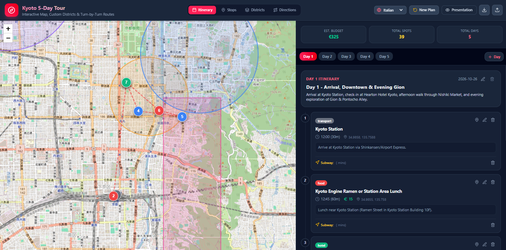

# Travel Planner

A day-by-day travel planner built with React and Redux.
Plan your itinerary on an interactive map, organise stops by category, draw districts, and see routes, timings and costs at a glance.

<!-- Replace with a full-window screenshot of the app -->

## Features

### Itinerary

Plan each day as an ordered list of stops.
Every stop has a name, category, start time, duration, cost and notes.
Stops are numbered on the map and connected by route lines, with a dashed fallback line when no route is available.

### Stops

Create, edit and delete stops.
While creating or editing, click anywhere on the map to set the stop's location.
A temporary marker shows where the stop will be placed.

### Districts

Mark areas of interest as circles (center and radius) or polygons (a set of vertices), each with its own color and notes.

### Map

- Interactive [Leaflet](https://leafletjs.com/) map
- Switchable map language
- Category-colored markers with popups (time, duration, cost, notes)
- Route polylines between consecutive stops

## Getting started

### Prerequisites

- Node.js 18 or newer
- npm, yarn or pnpm

## Roadmap

- [ ] Multiple trips
- [ ] Drag markers to move stops
- [ ] Offline support
- [ ] Add Landmarks

## Contributing

Issues and pull requests are welcome.
For larger changes, please open an issue first to discuss what you would like to change.
